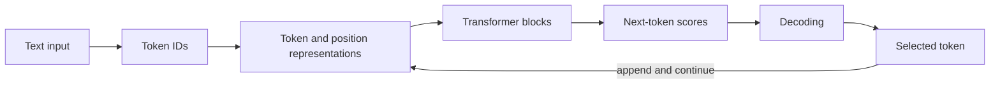

# LLM Fundamentals

Suppose an employee asks an internal assistant, "How many days of annual leave do I get?" The answer may look like a simple sentence, but several things have to happen before it appears. The question must be converted into tokens, placed inside the model's context window, processed by a Transformer and turned into a sequence of output tokens.

Understanding that path makes the rest of AI engineering much easier. It also helps separate what the language model does from what the surrounding application does.

## What is a large language model?

A language model estimates which text is likely to come next. Given:

> Employees can carry unused annual leave into the...

it might assign high probability to tokens representing "next year" and lower probability to unrelated continuations such as "database server."

A modern generative large language model, or LLM, is usually a neural network based on the Transformer architecture. It has learned statistical patterns from a large amount of data and stores those learned patterns in numerical parameters, commonly called **weights**. There is no universal parameter count at which a model officially becomes "large"; the term describes the scale of the model, its training data and the computation used to train it.

When an LLM generates text, it repeats a simple-looking process:

1. Read the tokens currently available as context.
2. Calculate a score for every possible next token.
3. Choose one token using a decoding strategy.
4. Add that token to the sequence and repeat.

This is called **autoregressive generation**. A whole paragraph is produced one token at a time, even when it appears on screen as a continuous stream.

The training objective sounds narrow, but predicting text well requires the model to learn many useful patterns: grammar, relationships between concepts, common facts, code structure and ways in which people express an intention. That is why the same underlying model can summarize a document, explain a program or draft an email. It does not mean the model understands those things exactly as a person does, or that every pattern it learned is correct.

### The model is only one part of the system

People often use "LLM" to mean an entire assistant. Keeping the layers separate prevents a lot of confusion.

| Layer | What it is responsible for |
|---|---|
| **Model** | Processes the supplied context and generates output from its learned weights. |
| **Model service or API** | Runs the model and may expose controls for output length, tools, decoding or conversation state. |
| **Application** | Manages the user experience, instructions, authorization, conversation history, retrieval, tools and persistent data. |

A model by itself does not open an HR system, retrieve a policy or remember an employee. An application can give it those abilities. Likewise, an API may store conversation state, or an application may resend earlier messages on every request. Either way, the model can act only on information made available in its current context.

For the leave question, the application should provide the relevant policy and employee-specific information from authorized sources. The model's trained knowledge must not be treated as the authoritative copy of a private or changing company policy.

### Pre-training and post-training

Most general-purpose generative LLMs go through at least two broad phases:

1. **Pre-training** teaches the model broad language patterns, usually by asking it to predict missing or subsequent tokens across a very large dataset. This produces a base model.
2. **Post-training** shapes the base model into a more useful assistant. Depending on the model, this can include supervised examples of desired responses, preference-based training, safety training and task-specific techniques.

Training changes the model's weights. Supplying a document in a prompt does not normally retrain the model; it gives the model temporary information to use during that request. This difference between **knowledge encoded in weights** and **information supplied as context** becomes important in RAG, agents and context engineering.

## Tokens: the units an LLM processes

An LLM does not receive text in the form displayed by an editor. A **tokenizer** converts text into a sequence of vocabulary entries called **tokens**, and each token has a numeric ID.

A token might represent:

- a complete common word;
- part of a longer or less common word;
- punctuation or whitespace;
- a byte or character sequence, depending on the tokenizer.

The following is a conceptual example, not the output of a particular tokenizer:

```text
"annual leave policy"
        ↓ tokenization
["annual", " leave", " policy"]
        ↓ vocabulary lookup
[token ID 1, token ID 2, token ID 3]
```

Actual boundaries differ between tokenizers. Even the same model family can use a different tokenizer in a later version.

### Why use pieces instead of whole words?

A whole-word vocabulary would be unable to cover every name, technical term, spelling variation and newly invented word without becoming impractically large. Splitting everything into individual characters would solve the vocabulary problem but would create much longer sequences.

Subword tokenization is a compromise. Common text can use relatively few tokens, while unfamiliar text can still be represented using smaller pieces. Byte Pair Encoding and unigram language-model tokenization are two common approaches; tools such as SentencePiece can implement them. Details differ between tokenizers.

After tokenization, the model converts each token ID into a vector called a **token embedding**. That vector is the starting numerical representation processed by the Transformer. Embeddings used for semantic search are related in spirit but serve a different purpose; they are covered in [Embeddings and Vector Databases](../02-embeddings-and-rag/embeddings-and-vector-databases.md).

### Why token counts matter in engineering

Tokens affect several practical limits:

- **Capacity:** context-window and output limits are measured in tokens.
- **Cost:** many hosted services charge separately for input and output tokens.
- **Latency:** more input takes more work to process, and more output takes more generation steps.
- **Text behavior:** spelling, exact character counting and unusual identifiers can be difficult because token boundaries do not necessarily match character or word boundaries.

You may see estimates such as one token being roughly four English characters. Such estimates are useful only for rough planning. Language, formatting, code, URLs and the selected tokenizer can change the result substantially. Use the tokenizer or token-counting API for the exact model when limits or cost matter.

## The context window: what the model can use right now

The **context** is the information available to the model for the current generation. It can include instructions, messages, retrieved documents, tool results, images or other supported inputs. The generated answer also becomes part of the sequence as it is produced.

The **context window** is the model's capacity for that information, measured in tokens. A simplified budget looks like this:

```text
instructions
+ conversation history
+ retrieved policy text
+ tool results
+ current question
+ generated output
≤ context-window limit
```

Exact accounting is provider- and model-dependent. Some systems publish separate input and output limits, while others describe one combined window with an additional output cap. Reasoning tokens and non-text inputs may also count. The model's documentation is the source of truth for a production integration.

For the leave assistant, sending a 200-page employee handbook is possible only if it fits, but it is rarely the best design. Retrieving the few sections relevant to annual leave gives the model less irrelevant material to work through and leaves more capacity for instructions, conversation and the answer.

### Context is not the same as memory

The model's weights are relatively stable knowledge learned during training. Context is temporary working information supplied during inference. Persistent memory is data stored outside the model and brought back when needed.

An assistant may appear to remember an earlier conversation because its platform stores and restores previous messages. That is a capability of the system around the model, not evidence that the model independently remembered an earlier API call. The distinction is explored further in [Instructions, Context and Memory](../04-context-engineering/instructions-context-and-memory.md).

### When the context becomes too large

Depending on the service and application, an oversized request may be rejected, older information may be removed or summarized, or the available output may be shortened. Staying just below the technical limit is not necessarily a good target either.

A large context window means the model can accept more information; it does not guarantee that the model will use every part equally well. Research has shown that model performance can vary with the position of relevant information in a long input. More context also tends to increase processing time and can increase cost.

Common context-management strategies include:

- selecting only information needed for the current task;
- retrieving relevant document sections instead of sending an entire collection;
- summarizing older conversation turns while preserving important decisions;
- removing duplicated or obsolete tool results;
- reserving enough capacity for the expected output.

This selection work is a central part of **context engineering**. A larger window is useful, but it is not a substitute for giving the model clear and relevant information.

## How a Transformer processes the context

The Transformer architecture was introduced in the 2017 paper *Attention Is All You Need*. The paper described an encoder-decoder architecture for sequence-to-sequence tasks such as translation. Many generative LLMs use a decoder-oriented variation designed to predict the next token. "Transformer" therefore names a family of related architectures, not one fixed implementation shared by every model.

At a high level, generation follows this path:



### Position matters

Attention alone does not know whether one token appeared before or after another. Transformers therefore add position information to the token representations. Different model families implement positional information differently, but the goal is the same: `policy updates leave` must not look identical to `leave updates policy`.

### Self-attention connects relevant tokens

**Self-attention** allows each position to build a context-aware representation using other relevant positions in the sequence.

One useful way to understand the mechanism is through three roles:

- A **query** represents what the current position is looking for.
- A **key** represents what another position can be matched on.
- A **value** carries the information that can be incorporated if the match is useful.

The model compares queries with keys, converts those matches into attention weights and combines the corresponding values. These operations are learned; developers do not write rules saying that one particular word must attend to another.

Imagine the supplied policy says:

> Employees who have completed five years may carry over ten unused leave days.

When answering "How many days can a six-year employee carry over?", attention helps the representation at the answer position draw on relationships among "six-year," "completed five years," "carry over" and "ten." Attention supports that connection, but it is not a database lookup or a guarantee that the final answer will be correct.

Generative LLMs normally use **causal attention**: a position can use the tokens that came before it, but not future output tokens that have not been generated. During training this is enforced with a causal mask. During generation the future tokens simply do not exist yet.

### Why multiple attention heads?

A Transformer block uses several attention heads in parallel. Each head has its own learned projections, allowing the block to represent different relationships at the same time. It is tempting to label one head "grammar" and another "facts," but real behavior is usually distributed and less tidy than that analogy suggests.

Attention is only part of a Transformer block. Blocks also contain feed-forward networks that transform each position's representation, plus residual connections and normalization that help information and gradients move through many stacked layers. Repeating these blocks builds increasingly contextual representations.

At the end, the model converts the final representation into one score for each token in its vocabulary. These raw scores are called **logits**. A decoding method turns the logits into the next selected token.

### Why long context requires more computation

In standard dense self-attention, positions are compared with many other positions, so attention work grows quickly as the sequence becomes longer. Modern models use various architectural and systems optimizations, and generation commonly caches key and value representations from earlier tokens instead of recomputing all of them. Even with such optimizations, longer inputs still consume memory and computation. Context size is therefore an engineering trade-off, not just a feature number.

## From logits to output: temperature and sampling

The model does not directly produce the next word. It first produces logits for its vocabulary. A softmax operation can convert those scores into a probability distribution.

Suppose the policy context leads to this made-up distribution for the next token:

| Candidate token | Illustrative probability |
|---|---:|
| `ten` | 0.64 |
| `10` | 0.21 |
| `five` | 0.07 |
| `up` | 0.03 |
| all other tokens | 0.05 |

The numbers are illustrative, but the decision is real: should the system always take the most likely token, or sample among plausible candidates? **Decoding** is the process used to make that choice.

### Temperature changes the shape of the distribution

**Temperature** scales the logits before probabilities are calculated.

- A temperature below `1` makes the distribution sharper. High-probability tokens become more dominant, so output tends to be more focused and repeatable.
- A temperature above `1` makes the distribution flatter. Lower-probability tokens get more opportunity, so output tends to vary more.
- A temperature of `1` leaves the logits at their original scale.

Some APIs use `0` to request greedy or near-greedy decoding, but this is an API convention rather than literal division by zero in the formula.

Temperature is often described as a creativity control. That is a useful shortcut, but technically it controls randomness in token selection. Lower temperature does not verify a fact, and higher temperature does not deliberately invent a good idea. For an answer that must quote a leave policy, a lower-variance configuration may be appropriate, but correctness still depends on authoritative context and evaluation.

Even low-temperature output is not guaranteed to be identical across every service, model or hardware configuration. If exact reproducibility matters, verify what the chosen platform supports rather than assuming that one parameter provides it.

## Top-K and Top-P sampling

Temperature changes the relative probabilities of tokens. **Top-K** and **Top-P** limit which tokens remain eligible for sampling.

### Top-K: keep a fixed number of candidates

Top-K keeps the `K` highest-probability tokens and removes the rest. If `K = 3` in the illustrative table, only `ten`, `10` and `five` remain. Their probabilities are normalized again before sampling.

A small K produces a narrow candidate set. A larger K permits more variety, but the fixed count does not adapt to whether the model is confident or uncertain at a particular step.

### Top-P: keep enough probability mass

Top-P, also called **nucleus sampling**, sorts tokens by probability and keeps the smallest set whose cumulative probability reaches at least `P`.

With `P = 0.8` in the illustrative table, `ten` alone is not enough, but `ten` plus `10` reaches `0.85`, so those two tokens form the candidate set. At another generation step, reaching the same threshold might require many tokens. Top-P therefore adapts the candidate-set size to the shape of the distribution.

| Control | What it changes | Practical characteristic |
|---|---|---|
| **Temperature** | Relative probability of candidates | Makes the distribution sharper or flatter. |
| **Top-K** | Number of eligible candidates | Uses a fixed maximum candidate count. |
| **Top-P** | Cumulative probability retained | Uses an adaptive candidate count. |

These controls can interact. Changing all of them together makes behavior harder to reason about, so application teams normally evaluate decoding settings against a real task instead of relying on a universal "best" value.

They are also not exposed consistently. A provider may support only some controls, assign them different ranges, ignore them for particular models or remove them from newer APIs. The concepts remain useful for understanding generation, but production code must follow the selected model's current documentation.

## Following the leave question from input to answer

We can now connect the pieces:

1. The employee asks, "How many days can I carry over after six years?"
2. The application retrieves the authorized leave-policy section and adds it to the request with the relevant instructions and conversation history.
3. The complete request is tokenized. Everything must fit within the model's context limits while leaving capacity for the answer.
4. Transformer blocks use causal self-attention and other learned operations to build contextual representations of the supplied tokens.
5. The model produces logits for the next token. The decoding strategy selects one token, then generation continues token by token.
6. The application returns the answer and may attach the policy source, enforce access rules or record audit information.

Step 3 prepares the model input; steps 4 and 5 are model inference. Retrieval, authorization, citations, memory and the user interface belong to the larger system. This boundary is important: changing temperature cannot repair a missing policy, and increasing the context window cannot repair an authorization mistake.

## What to carry forward

- A modern generative LLM produces text by repeatedly predicting the next token.
- Tokens are model-specific units, not reliably equivalent to words or characters.
- The context window limits what the model can use during a generation; it is not persistent memory.
- A Transformer combines attention with other learned operations across many layers.
- Causal self-attention lets generated tokens use earlier context without seeing future output.
- Temperature, Top-K and Top-P influence selection and variation, not factual correctness.
- The model, its API and the surrounding application have different responsibilities.

The next page explains how instructions and examples are arranged to steer this generation process: [Prompt Engineering](prompt-engineering.md).

## References

- Vaswani et al., [*Attention Is All You Need*](https://arxiv.org/abs/1706.03762) (2017).
- Ouyang et al., [*Training Language Models to Follow Instructions with Human Feedback*](https://arxiv.org/abs/2203.02155) (2022).
- Holtzman et al., [*The Curious Case of Neural Text Degeneration*](https://arxiv.org/abs/1904.09751) (2019), which introduced nucleus sampling.
- Liu et al., [*Lost in the Middle: How Language Models Use Long Contexts*](https://arxiv.org/abs/2307.03172) (2023).
- Google AI for Developers, [Understand and Count Tokens](https://ai.google.dev/gemini-api/docs/tokens).
- Hugging Face Transformers, [Text Generation](https://huggingface.co/docs/transformers/main_classes/text_generation).
