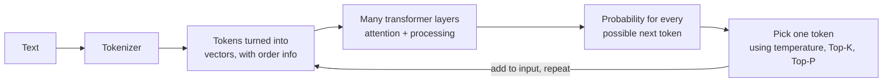

# LLM Fundamentals

Most of AI engineering sits on top of one idea: a model that predicts the next piece of text. This page covers that idea and the handful of terms you will keep running into: tokens, the context window, temperature, sampling and the transformer. Later sections (RAG, agents, MCP, context engineering) all build on these.

To keep things concrete, we will follow one hypothetical example throughout: an employee asking an internal assistant, "How many days of leave do I get?"

## What are Large Language Models (LLMs)?

Think of the autocomplete on your phone, but trained on a huge amount of text and with a far better sense of context. Given "The capital of France is", it predicts " Paris" is the likely next piece. An LLM does exactly this, one piece at a time, and keeps going until the answer is complete.

Technically, an LLM is a neural network (a transformer, covered below) trained to predict the next token. Answering questions, writing code and summarizing documents all come out of that single skill.

Most chat models are built in two broad stages:

1. **Pre-training:** the model reads a very large amount of text and learns to predict what comes next. This is the expensive part.
2. **Post-training:** the model is further trained to follow instructions and respond helpfully and safely. This is what turns a text predictor into an assistant.

Three consequences are worth remembering, because they explain a lot of behavior you will see later:

- **It predicts, it doesn't look things up.** That is why a model can sound confident and still be wrong (see [AI Security and Reliability](../05-ai-security-and-reliability/ai-security-and-reliability.md)).
- **Its knowledge stops at a training cutoff.** It doesn't know your company's policies or yesterday's news unless you give them to it.
- **It has no memory between requests.** Each API call stands alone. Chat apps feel like they remember you only because the application sends the earlier conversation again with every new message.

So for our leave question, a bare model has never seen your HR policy. It will either admit that or guess something plausible. Fixing that is what RAG is for, covered in [RAG Architecture and Optimization](../02-embeddings-and-rag/rag-architecture-and-optimization.md).

## Tokens and tokenization

An LLM doesn't read letters or whole words. It reads **tokens**, which are chunks of text, often a word or part of a word. A **tokenizer** converts your text into tokens before the model runs, and converts the model's output back into text afterwards.

A good analogy is syllables. Common words like "password" are often a single token, while a rare or long word gets split into several pieces. Each piece maps to a number in a fixed vocabulary, and the model only ever works with those numbers.

```
"Reset my password"  →  ["Reset", " my", " password"]  →  [IDs the model sees]
```

Why not just use whole words? The vocabulary would need to be enormous and could never cover new words, names or typos. Why not single characters? Sequences would become very long and slow. Sub-word tokens (built with methods such as Byte Pair Encoding) sit in the middle.

### Why you should care about tokens

Tokens are the unit that everything is measured in: the size of the context window, the length limit on a response and, usually, the price of an API call.

A common rule of thumb for English is that a token is roughly four characters, or about three quarters of a word. Treat that as a rough guide only:

- Code, JSON, URLs and non-English text usually need more tokens than the same amount of plain English.
- Different models use different tokenizers, so the same text can have different token counts. If precision matters, count with the tokenizer of the model you actually use.

An illustrative example: pasting a long HR policy PDF plus a chunk of JSON into a prompt can use far more tokens than the page count suggests. That affects both cost and how much room is left for the answer.

One more side effect: since the model sees tokens and not characters, tasks like counting the letters in a word can trip it up.

## Context window and context limits

The context window is the maximum amount of text, measured in tokens, that a model can consider in a single request. A useful picture is a **desk**. The model can only work with what is on the desk right now. Anything that isn't on it, the model can't see.

In most APIs, the desk is shared by the input and the output. Your instructions, the conversation so far, any documents you include and the answer the model is writing all have to fit together. Many APIs also cap the length of the answer separately.

For the leave question, the desk might hold:

- the assistant's instructions
- the conversation so far
- the relevant section of the HR policy
- the employee's question
- the answer being written

In an AI coding assistant, file contents, search results and command output pile onto the same desk as the session goes on.

### Context is not memory

This is worth saying plainly. The context window is working space for one request, not long-term memory. When an assistant "remembers" you across sessions, the application stored something and put it back on the desk. That idea is covered in [Instructions, Context and Memory](../04-context-engineering/instructions-context-and-memory.md).

### What happens when the desk gets full

- The request can fail, or the application has to drop or summarize older content.
- Long before that, a very full context can hurt quality. Models don't always make equal use of everything in a long input, and details buried in the middle can get missed.
- Cost and response time grow with the amount of input.

Window sizes differ by model and keep growing, so check the documentation of the model you use. A bigger window helps, but it doesn't replace choosing what goes in. Putting a smaller amount of well-chosen information on the desk is usually cheaper and more accurate than dumping everything in.

Typical ways to manage the desk:

- **Trim** old or low-value messages.
- **Summarize** a long history into a short note.
- **Retrieve** only the relevant pieces, which is the idea behind RAG.
- **Delegate** a task to a sub-agent that starts with its own clean desk (see [Skills and Sub-Agents](../04-context-engineering/skills-and-sub-agents.md)).

## Temperature and its impact on output

After reading the context, the model doesn't pick a single next token. It assigns a probability to every possible token. **Temperature** controls how adventurous the model is when choosing from them.

Picture a creativity dial:

- **Low temperature:** the model almost always takes the most likely token. Answers are focused and consistent.
- **High temperature:** less likely tokens get a real chance. Answers become more varied, and also more likely to wander or get things wrong.

For the leave question, you want the low end. You are extracting a fact from a policy, and creativity is not helpful. For brainstorming names for an internal tool, a higher setting is more useful.

Two things to keep in mind:

- Low temperature gives consistency, not correctness. A model can repeat the same wrong answer very reliably.
- Even at the lowest setting, outputs aren't guaranteed to be identical on every run.

Which sampling settings you can change, and their allowed ranges, differ by provider and model, and some models restrict them. Check your provider's documentation.

## Top-K and Top-P sampling

Temperature reshapes the probabilities. Top-K and Top-P do something different: they shrink the list of candidates before the model picks.

- **Top-K** keeps only the K most likely tokens. With K = 40, the model picks from the 40 best options and ignores everything else.
- **Top-P** (also called nucleus sampling) keeps the smallest group of tokens whose probabilities add up to P. With P = 0.9, the model takes the best options until they cover 90% of the probability, and ignores the rest.

The difference is that K is a fixed number, while the Top-P group adapts. When the model is very sure, only a few tokens make the cut. When it is unsure, more of them do.

| | Top-K | Top-P |
|--|-------|-------|
| Cuts the list by | A fixed count | Cumulative probability |
| Size of candidate group | Same every step | Changes every step |

All three settings (temperature, Top-K, Top-P) influence the same choice, so changing several at once makes behavior hard to predict. It is usually simpler to adjust one at a time, and for most application work the defaults are fine. Not every provider offers all three, so check what yours supports.

## Transformers and attention mechanism

The transformer is the neural network design behind modern LLMs, introduced in the 2017 paper "Attention Is All You Need". You don't need the math to talk about it. The key idea is **attention**.

Consider the sentence: "The server rejected the request because **it** was malformed." What does "it" refer to? To get this right, the model has to connect "it" with the right earlier word. Attention is the mechanism that lets each token look at every other token in the input and decide how much each one matters. It is like re-reading a sentence and, for each word, checking which other words explain it.

Here is the overall flow when a model generates text:



1. The text is split into tokens.
2. Each token becomes a vector (an embedding), and the model is also given information about token order, since attention by itself doesn't know which word came first.
3. The vectors pass through many layers. In each layer, attention lets tokens share information, and further processing refines each one.
4. The output is a probability for every token in the vocabulary.
5. One token is picked using the sampling settings above, added to the input, and the whole loop repeats.

This loop is called autoregressive generation, and it explains why long answers take longer: the model produces them one token at a time.

Two things to carry forward:

- Attention is how the model makes use of everything in the context window. It is also why very long inputs get expensive, since every token can look at every other token.
- What the model learned in training is stored in its parameters (weights). Attention works over what is in the current context. That split between "learned in training" and "provided in the context" is the root of the next section's topics. Embeddings, the vectors mentioned in step 2, are explained in [Embeddings and Vector Databases](../02-embeddings-and-rag/embeddings-and-vector-databases.md).

## Where to go next

You now know how a model reads text, how much it can hold, and how it chooses its words. The next step is learning how to steer it: [Prompt Engineering](prompt-engineering.md).

## Further reading

- Vaswani et al., "Attention Is All You Need" (2017): https://arxiv.org/abs/1706.03762
